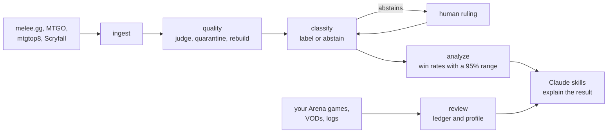

# MTG Data

[](https://github.com/Phillip-Hurst/MTG-Data/actions/workflows/ci.yml)

Magic: The Gathering tournament results, from the scrape to a meta read you can
check, plus a reviewer for your own games that asks before it grades. A Python
pipeline pulls results from melee.gg, MTGO, mtgtop8 and Scryfall, decides which of
them belong, labels every deck, and turns what's left into win rates with their
uncertainty attached. It ships as a Claude plugin with four skills that run the
pipeline and explain what it found.

## The problem

Tournament results are public and they are dirty. An event index says Standard and
the decklists say Modern. Pre-ban results sit in the same files as post-ban ones,
under the same names. One deck is filed under five names by five sites. A win rate
computed on that pool still prints to one decimal place, and it still reads like a
fact.

That happened here. In August 2026, 1,316 of 1,708 pairing rows in a "post-ban
Standard" pool didn't belong, among them a pre-ban event, a Modern team event and
an Artisan side event. Every script exited 0. A published note put a deck at 6.8%
of the metagame 17 days after one of its cards was banned.

Most of this repo is the answer to that.

## How a number earns its place

**Events are judged by their decklists.** Every scraped event is checked against
the format's legal card pool and the ban list as of the era's start. Events that
fail are quarantined with a reason and kept on disk. On a run on 2026-10-12, 17 of
53 events were quarantined and 1,082 of 2,877 pairing rows never reached a win
rate.

**The pool is rebuilt from its sources every time.** One module writes the
combined pool, from the per-event files, with the verdicts applied. A rebuild of
the same input is byte-identical.

**The classifier says when it isn't sure.** It names a deck only when one
reference clearly beats the rest. Otherwise it abstains with a reason, the deck
goes to a review queue, and a person's ruling survives the next scrape. Until
someone rules, the organizer's own label stands in, and it's counted separately.

**Win rates carry a 95% range.** The win-rate tracker, the archetype notes and the
meta snapshot's tier list print a Wilson interval beside each win rate. Ten decided
games at 60% runs from 31% to 83%.

**Validation and snapshots fail closed.** Validation exits non-zero when it can't
read an event file. A snapshot is refused from a pool that was never validated,
was validated for another era, or was rescraped since. Each one says why.

**Same data, same output.** `scripts/check_determinism.py` runs 22 offline
commands twice on a copy of real data under different hash seeds and compares
exit codes, output and every file written. Building it turned up three commands
that broke ties by set order, so the same data printed a different ranking each
run. All 22 runs match now, under three seed pairs.

Twenty rules like these are written down in [data quality](docs/data-quality.md),
each traced to the code that enforces it and the tests that pin it.

## Reviewing your own games

The other half of the plugin looks at one player instead of the field.
`vod-review` reads a game from an untapped.gg match log, a YouTube VOD, a pasted
log or screenshots, and finds the few decisions that decided it.

**It asks before it grades.** For each decision it flags, it asks what the read
was and what the player was playing around, at most three questions a match. A
sound read whose line still lost is graded correct, and only the player's answer
can show that.

**It judges the decision on what was known at the time.** A play that loses to the
one card that beats it is often right. A play that wins because the opponent had
nothing is often a punt.

**It counts habits instead of remembering them.** Every finding names one of 31
patterns in a fixed registry (`config/play_patterns.json`) and is appended to a
play ledger, one line per game. A pattern becomes a habit at 3 occurrences across 2
sessions; one bad night is one bad night. Strengths clear the same bar as leaks,
and a fixed leak stays visible as fixed.

**It flags its own confirmation bias.** The profile is read at the start of a
review and written at the end, which makes it easy to find the habit you expected.
A pattern found mostly because the profile predicted it is marked as such and is
never offered as the thing to work on.

Pace is measured from VOD timestamps or game durations, or declared unmeasurable;
it's never inferred from a loss. The ledger and the profile stay on the player's
machine.

## Getting started

```
git clone https://github.com/Phillip-Hurst/MTG-Data
cd MTG-Data
pip install -e ".[dev]"
python scripts/setup_workspace.py
```

Setup checks your Python, offers to install Playwright and Chromium, asks which
formats to track, builds a folder for each one, and pulls two things per format:
Scryfall's legal card pool and mtgtop8's current metagame. Then:

| Next step | Command | What it needs |
|---|---|---|
| Scrape results | `scrape.bat` or `./scrape.sh` in the format's folder | A browser: melee.gg only answers a visible Chrome window |
| Ask about the format | the `mtg-tournament-analysis` skill | A scrape, or the mtgtop8 seed for a first read |
| Review a game | the `vod-review` skill with a log, VOD or screenshots | Nothing. The ledger needs the workspace. |
| Look up a rule | the `rules-check` skill | Nothing |

Every pipeline step is also a command: `mtg --help` lists them in the order data
moves through them, and `python mtg.py --help` does the same with no install. The
[user guide](docs/user-guide.md) covers each one.

To add the skills to Claude:

```
/plugin marketplace add Phillip-Hurst/MTG-Data
/plugin install mtg-data@mtg-data
```

The plugin brings the skills; the clone holds your data. Keep both. A plugin update
replaces the plugin's own folder.

## The four skills

| Skill | What it does |
|---|---|
| `mtg-tournament-analysis` | Reads the format: meta share, win rates, matchup matrix, what moved week over week, and card-level signal across the field. |
| `deck-check` | Puts every deck under the right archetype name and pushes that name into the files the numbers are built from. |
| `vod-review` | Reviews your own games, interviews you about the decisions it flags, and keeps a play profile of your habits. |
| `rules-check` | Answers a rules question by quoting the current Comprehensive Rules with the rule number. |

[`CLAUDE.md`](CLAUDE.md) is the router between them.

## Architecture



Code computes every number. The skills decide which command answers a question,
read the files it writes, and explain the result. That keeps the arithmetic
testable.

More in [architecture](docs/architecture.md).

## Documentation

| | |
|---|---|
| [Architecture](docs/architecture.md) | The pipeline, where Claude sits, and the design decisions behind it |
| [Data quality](docs/data-quality.md) | The rules a result has to pass, traced to code and tests |
| [The classifier](docs/classifier.md) | How a deck gets its name, how well that works, and what it would take to trust it further |
| [Scope and limitations](docs/limitations.md) | What the numbers hold for, how to read them, and where they stop |
| [User guide](docs/user-guide.md) | Install, scrape, eras, baselines, the play profile, rules lookups |
| [The play profile](skills/vod-review/reference/play-profile.md) | The ledger's schema, the pattern registry, and the trend bar |
| [Changelog](CHANGELOG.md) | Every release, and the defect behind most of them |

## Limitations, briefly

The classifier's 93% agreement was measured on the decks its thresholds were tuned
on; there's no held-out test set yet. Win-rate ranges assume independent matches,
which Swiss rounds aren't. Melee results carry no event date. The scrapers break when melee.gg or MTGO
redesign a page. [The full list](docs/limitations.md).

## Credits and legal

Card names, costs and oracle text come from [Scryfall](https://scryfall.com). If
you extend the card-lookup code, keep to their
[API guidelines](https://scryfall.com/docs/api).

Tournament data is read from melee.gg, MTGO, mtgtop8 and MTGGoldfish for personal,
non-commercial analysis. It stays on the machine that scraped it. Check each site's
terms before redistributing anything.

Magic: The Gathering is © Wizards of the Coast. This is unofficial Fan Content
permitted under the
[Wizards of the Coast Fan Content Policy](https://company.wizards.com/en/legal/fancontentpolicy).
Not approved or endorsed by Wizards. Portions of the materials used are property
of Wizards of the Coast LLC.

Code is released under the MIT License. See [LICENSE](LICENSE).
