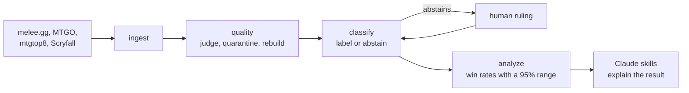

# MTG Data

[](https://github.com/Phillip-Hurst/MTG-Data/actions/workflows/ci.yml)

Magic: The Gathering tournament results, from the scrape to a meta read you can
check. A Python pipeline that pulls results from melee.gg, MTGO, mtgtop8 and
Scryfall, decides which of them belong, labels every deck, and turns what's left
into win rates with their uncertainty attached. It ships as a Claude plugin with
four skills that run the pipeline and explain what it found.

## The problem

Tournament results are public and they are dirty. An event index says Standard and
the decklists say Modern. Pre-ban results sit in the same files as post-ban ones,
under the same names. One deck is filed under five names by five sites. A win rate
computed on that pool still prints to one decimal place, and it still reads like a
fact.

That happened here. In August 2026, 1,316 of 1,708 pairing rows in a "post-ban
Standard" pool didn't belong: a pre-ban event, a Modern team event and an Artisan
side event. Every script exited 0. A published note put a deck at 6.8% of the
metagame 17 days after one of its cards was banned.

Most of this repo is the answer to that.

## How a number earns its place

**Events are judged by their cards.** Every scraped event is checked against the
format's legal card pool and the ban list as of the era's start. Events that fail
are quarantined with a reason and kept on disk. On a run on 2026-10-12, 17 of 53
events were quarantined and 1,082 of 2,877 pairing rows never reached a win rate.

**The pool is rebuilt from its sources every time.** One module writes the
combined pool, from the per-event files, with the verdicts applied. A rebuild of
the same input is byte-identical.

**The classifier says when it isn't sure.** A deck gets an archetype name only when
one reference clearly beats the rest. Otherwise it goes to a review queue with a
reason, a person rules on it, and the ruling survives the next scrape.

**Every win rate carries a 95% range.** Ten decided games at 60% runs from 31% to
83%, and the tracker says so.

**Validation and snapshots fail closed.** Validation exits non-zero when it can't
read an event file. A snapshot is refused from a pool that was never validated,
was validated for another era, or was rescraped since. Each one says why.

**Same data, same output.** The 22 offline commands were run twice on real data
under different hash seeds, and every output matched apart from timestamps. The
one that didn't, before 2.0.0, is fixed.

Twenty rules like these are written down in [data quality](docs/data-quality.md),
each traced to the code that enforces it and the test that pins it.

## Quick start

```
git clone https://github.com/Phillip-Hurst/MTG-Data
cd MTG-Data
pip install -e ".[dev]"
mtg --help
pytest
```

Every pipeline step is a command, listed in the order data moves through them. No
install needed for that: `python mtg.py --help` works from a fresh checkout.

Scraping melee.gg and MTGO needs a browser: `playwright install chromium`, then
`python scripts/setup_workspace.py` to build a folder per format. The
[user guide](docs/user-guide.md) walks through it.

## Architecture



Code computes every number. The Claude skills decide which command answers a
question, read the files it writes, and explain the result. That keeps the
arithmetic testable.

More in [architecture](docs/architecture.md).

## The Claude plugin

```
/plugin marketplace add Phillip-Hurst/MTG-Data
/plugin install mtg-data@mtg-data
```

| Skill | What it does |
|---|---|
| `mtg-tournament-analysis` | Reads the format: meta share, win rates, matchup matrix, what moved week over week, and card-level signal across the field. |
| `deck-check` | Puts every deck under the right archetype name and pushes that name into the files the numbers are built from. |
| `vod-review` | Reviews your own games from an untapped.gg match log, a YouTube VOD or a pasted log. Asks what you were thinking before it grades a decision, and keeps a running profile of your habits. |
| `rules-check` | Answers a rules question by quoting the current Comprehensive Rules with the rule number. |

[`CLAUDE.md`](CLAUDE.md) is the router between them.

## Documentation

| | |
|---|---|
| [Architecture](docs/architecture.md) | The pipeline, where Claude sits, and the design decisions behind it |
| [Data quality](docs/data-quality.md) | The rules a result has to pass, traced to code and tests |
| [The classifier](docs/classifier.md) | How a deck gets its name, how well that works, and what it would take to trust it further |
| [Scope and limitations](docs/limitations.md) | What the numbers hold for, how to read them, and where they stop |
| [User guide](docs/user-guide.md) | Install, scrape, eras, baselines, the play profile, rules lookups |
| [Changelog](CHANGELOG.md) | Every release, and the defect behind most of them |

## Limitations, briefly

The classifier's 93% agreement was measured on the decks its thresholds were tuned
on; there's no held-out test set yet. Win-rate ranges assume independent matches,
which Swiss rounds aren't. Melee results carry no event date. The scrapers break
when melee.gg or MTGO redesign a page. [The full list](docs/limitations.md).

## Credits and legal

Card names, costs and oracle text come from [Scryfall](https://scryfall.com). If
you extend the card-lookup code, keep to their
[API guidelines](https://scryfall.com/docs/api).

Tournament data is read from melee.gg, MTGO, mtgtop8 and MTGGoldfish for personal,
non-commercial analysis. It stays on the machine that scraped it. Check each site's
terms before redistributing anything.

Magic: The Gathering is © Wizards of the Coast. This is unofficial Fan Content
permitted under the
[Wizards of the Coast Fan Content Policy](https://company.wizards.com/en/legal/fancontentpolicy).
Not approved or endorsed by Wizards. Portions of the materials used are property
of Wizards of the Coast LLC.

Code is released under the MIT License. See [LICENSE](LICENSE).
