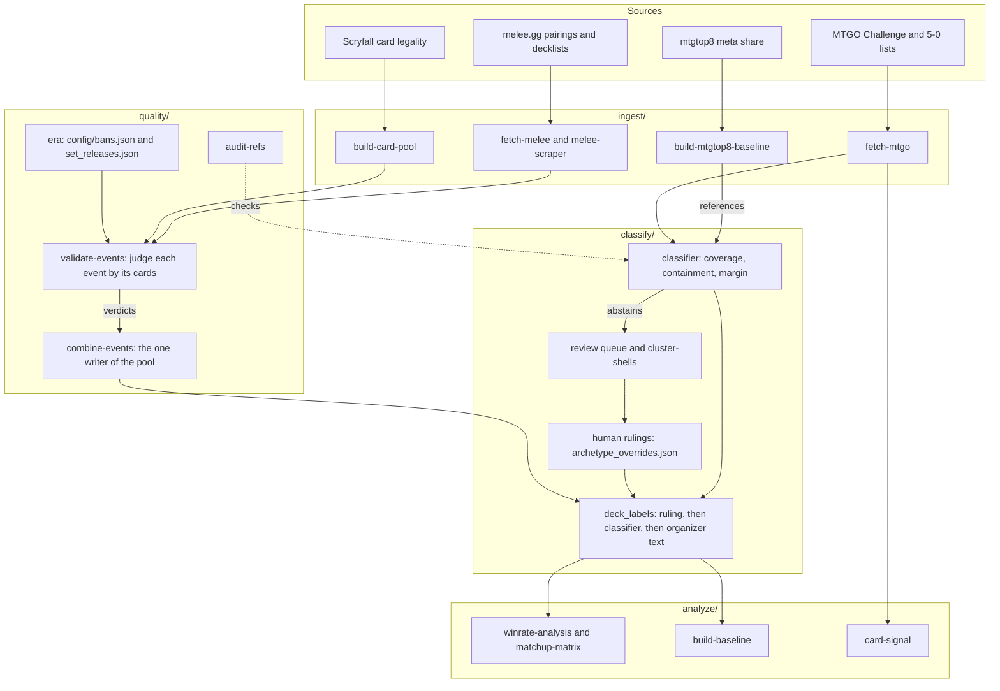

# Architecture

Tournament results arrive dirty and from five places. By the time a number reaches
a player it has been scraped, judged, rebuilt, labelled and counted, and each of
those steps writes a file the next one reads. This page is the map.

## The pipeline



`review/` sits beside this pipeline and shares only `core/` with it. It reads a
player's own Arena games from untapped.gg into an append-only play ledger, counts
that ledger into a profile of habits, and quotes the Comprehensive Rules.

## The stages

| Stage | Package | What leaves it |
|---|---|---|
| Ingest | `ingest/` | Per-event CSVs of pairings and standings, MTGO list dumps, a cached card pool, seed references |
| Quality | `quality/` | A verdict on every event, with a reason; one combined pool rebuilt from the per-event files; a coverage sidecar saying what's in it |
| Classify | `classify/` | One canonical archetype name per deck, or an abstention with a reason; human rulings kept apart from scraped data |
| Analyze | `analyze/` | Win rates with a 95% range, matchup matrices, week-over-week snapshots, card-level signal |
| Review | `review/` | A play ledger, a play profile, rules quoted by number |

Every stage is a command: `python mtg.py --help` lists them in this order.

## Where Claude sits

The repo is also a Claude plugin. Four skills in `skills/` are instructions,
written in markdown, that tell Claude which command answers which question and
what to check before quoting anything. [`CLAUDE.md`](../CLAUDE.md) is the router
between them.

The division of labour is deliberate. Code computes every number. Claude decides
which command to run, reads the files it writes, and explains the result to a
person. That keeps the arithmetic testable and the model's job to the part a model
is good at.

Two rules the skills carry come straight from this pipeline's failures: check the
era before quoting a number, and check that the pool was validated for that era.
They're enforced by instruction, which is weaker than enforcement by code. See
[limitations](limitations.md#known-limits).

## Design decisions

Each of these is here because its absence caused a defect that exited 0.

**Judge events by their cards.** A tournament index said an event was Standard;
its decklists said it was Modern. The decklists win. See
[data quality](data-quality.md).

**Derived files are rebuilt from their sources every time.** The combined pool used to be filtered
in place, so each validation run filtered the previous run's output. The standings
file went from 553 rows to 312 to 241 while 27 per-event files sat on disk
untouched. Now `combine-events` rebuilds it from the per-event files every time,
and a rebuild of the same input is byte-identical.

**One writer per file.** Three scripts wrote the combined pool with three
definitions of it. Three more wrote the archetype references and were wrong in
opposite directions: two replaced the whole file and dropped any reference the run
couldn't rebuild, and one only ever added, so a 3-deck seed outranked a 40-deck
rebuild forever. Each file now has one module that writes it, and a test fails if
another module opens it for writing.

**Nothing is deleted.** Quarantined events are renamed, archived eras are moved,
and replaced references are backed up first. A wrong verdict can be reversed.

**Human rulings live apart from scraped data.** A re-scrape refetches every
decklist with whatever label the classifier gives it. Before the overrides file
existed, every scrape silently undid every correction.

**A ban is a reset.** File names don't change at a ban and archetype names don't
change either, so a win rate against a deck that can no longer be registered still
reads like a fact. Results are compared within one era only.

**Fail closed and count.** A step that can't verify its input says so, names what
it couldn't read, and exits non-zero. Every step reports how many rows it kept and
dropped.

**Local first.** Scraped data and the play ledger stay on the machine that made
them. `.gitignore` keeps them out of the repo, and the plugin bundle is built from
an allow-list so a new kind of local file can't ship by accident.

## Which file each consumer reads

Fixing data means fixing the file the consumer reads, which isn't always the one
that looks canonical.

| Consumer | Reads |
|---|---|
| `winrate-analysis`, `matchup-matrix`, `update-archetypes` | the pool via `combine_events.load_pool(..., resolve_names=True)` |
| `build-baseline` | `melee_<fmt>_all_standings.csv`, and `deck_labels` for every deck name |
| `combine-events` | the per-event `melee_<fmt>_<id>_*.csv`, live and quarantined |
| `deck_labels` | `melee_deck_cache.json`, `archetype_refs.json`, `archetype_overrides.json` |
| `card-signal` | `mtgo_*_latest.json` mainboards and sideboards, plus `card_pool_<fmt>.json` |
| `play-profile` | `play_log.jsonl`, and it rewrites the play profile notes |

## Repository layout

```
mtg.py                 run any command from a checkout: python mtg.py --help
pyproject.toml         package metadata, ruff and pytest config
config/                versioned reference data: bans, set releases, archetype
                       names, the play pattern registry
src/mtg_data/
  cli.py               the command registry
  core/                paths, format eras, counting rules and intervals
  ingest/              scrapers and source fetchers
  quality/             validation, the pool writer, reference audit, era archive
  classify/            classifier, references, labels, human corrections
  analyze/             win rates, matchups, snapshots, card signal
  review/              Arena log parser, play profile, rules lookup
skills/                the four Claude skills and their reference notes
scripts/               workspace setup and the plugin bundle builder
tests/                 400+ tests, no network
docs/                  this page and its neighbours
```
